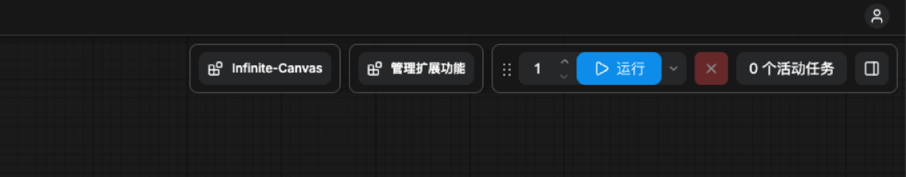
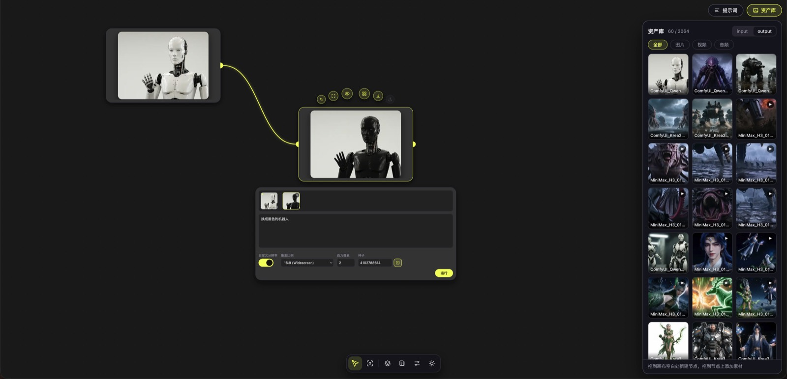
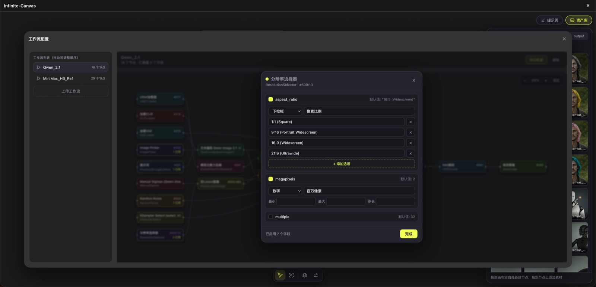
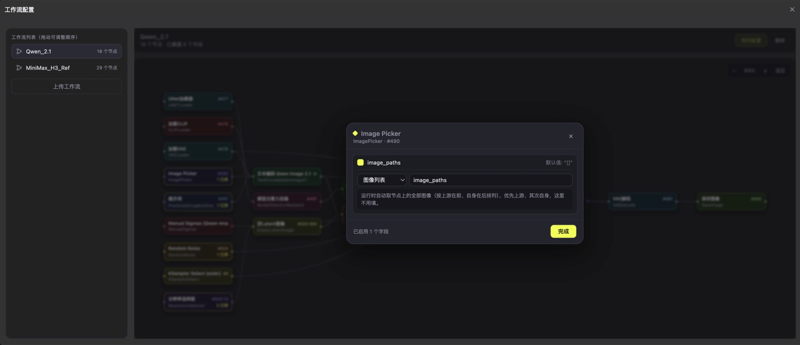

# ComfyUI-Infinite-Canvas

把 ComfyUI 变成一块「无限画布」：每个节点绑定一条工作流，在画布上直接跑图、出视频，产出的素材还能拖到下一个节点继续用。

前端是 Vue 3 + Vue Flow，后端是一个轻量 aiohttp 扩展，只负责托管页面、读写配置、代理执行与缩略图生成。





## 功能

**画布**

- 无限平移 / 缩放，支持全览与单节点聚焦

- 多画布管理：新建、重命名、删除（支持批量）、切换，改动自动保存

- 节点素材可以拖出画布空白处新建节点，拖到别的节点上则作为素材追加

**节点**

- 一个节点 = 一条 ComfyUI **API 格式**工作流，运行时整个节点变成进度条（排队 / 进度 / 报错）

- 节点面板：切换工作流、填写提示词、按字段类型自动渲染控件（文本、数字、滑块、下拉、开关）

- 工作流里哪些字段暴露到画布，由「工作流配置」逐条勾选

- 支持图片 / 视频 / 音频结果，多条素材以扇形卡片堆叠展示

**资产库**

- 读取ComfyUI `input` / `output` 目录，可切分 图片 / 视频 / 音频

- 分页懒加载（每页 60 条，滚动到底自动加载下一页）

- 服务端生成并缓存 WebP 缩略图，视频自动抽帧做封面，网格只加载缩略图

- 悬停气泡快速预览（图片用缩略图秒开，视频原片静音循环）

- 拖到画布空白处新建节点、拖到节点上追加素材 —— 拖出来用的始终是**原图 / 原文件**，缩略图只用于面板展示

**提示词库**

- 手动收藏、持久化保存

- 节点提示词框里输入 `@` 打开资产库、`/` 打开提示词库，点击条目直接插入

**底部工具栏**

| 图标    | 作用                       |
| ----- | ------------------------ |
| 纸飞机   | 恢复默认缩放，并把当前（或上一次点击的）节点居中 |
| 全览    | 缩放到能看到整块画布               |
| 画布管理  | 多画布的增删改与切换               |
| 工作流配置 | 上传 / 排序 / 配置工作流字段        |

## 安装

```bash
cd ComfyUI/custom_nodes
git clone https://github.com/YangShu2103/ComfyUI-Infinite-Canvas.git ComfyUI-Infinite-Canvas
```

重启 ComfyUI，顶部菜单就会出现 `Infinite-Canvas` 入口。

- 前端构建产物已随仓库提交（`frontend/dist`），**普通用户不需要 Node.js 环境**。

### 可选依赖

| 用途    | 依赖                     | 说明                                   |
| ----- | ---------------------- | ------------------------------------ |
| 图片缩略图 | Pillow                 | ComfyUI 自带，必需                        |
| 视频封面  | `av` 或 `opencv-python` | 二选一即可（`pip install av`）；都没有时视频显示占位图标 |

## 使用

1. 打开入口 → **工作流配置**：上传 ComfyUI 导出的 **API 格式** 工作流 JSON（`Workflow → Export (API)`），并勾选要暴露到画布的字段。

   

2. 画布空白处双击新建节点，在参数面板左侧工作流列表选择一条工作流。

3. 在节点面板里填提示词、调参数，点运行，产出会直接出现在节点上。

4. 把节点上的素材拖到下一个节点，即可衔接下一条工作流。

## 推荐搭配：[ComfyUI\_image\_picker](https://github.com/YangShu2103/ComfyUI_image_picker)

工作流里需要一次性接收 **多张图（图像列表）** 时，推荐配合 [ComfyUI\_image\_picker](https://github.com/YangShu2103/ComfyUI_image_picker) 节点使用：



```bash
cd ComfyUI/custom_nodes
git clone https://github.com/YangShu2103/ComfyUI_image_picker.git ComfyUI_image_picker
```

- 它提供 `img_1` … `img_9` 共 9 个 `IMAGE` 输出，正好对应画布节点上追加的多张素材（按素材顺序依次送入）

- 带可视化的图库弹窗（`input` / `output` 多选、缩略图、拖拽排序），不用为每张图单独挂一个 `LoadImage`

## 数据存放

插件的持久化数据不在节点目录里，而是放在 ComfyUI 的用户目录下，重装 / 更新节点不会丢：

```
<user_directory>/ComfyUI-Infinite-Canvas/
├── canvas_settings.json   # 画布设置、工作流排序
├── prompts.json           # 提示词库
├── workflows/             # API 格式工作流 + <名称>.fields.json
├── canvases/              # 画布
└── thumbs/                # 缩略图缓存（可随时整目录删除，会自动重建）
```

`<user_directory>` 即 `folder_paths.get_user_directory()` 返回的目录（通常是 `ComfyUI/user`）。

缩略图按「源文件路径哈希 + 修改时间 + 大小」命名，源文件变了会自动生成新缓存；缓存总量超过 10000 个文件或 200MB 时，按最旧优先清理。

## 开发

```bash
cd frontend
npm install
npm run dev     # 本地调试：http://localhost:5173
npm run build   # 构建到 frontend/dist，ComfyUI 直接加载
```

- `vite dev` 下「工作流配置」可以填后端地址；打包上线后固定用当前 ComfyUI。

- 改完前端记得 `npm run build`；改 `web/infinite_canvas.js` 或 `__init__.py` 需要**重启 ComfyUI**。

### 目录结构

```
ComfyUI-Infinite-Canvas/
├── __init__.py            # 后端：路由、工作流/画布读写、缩略图
├── web/infinite_canvas.js # 前端扩展：注入顶部入口 + iframe 弹窗
├── docs/images/           # README 里的截图
├── frontend/              # Vue 3 + Vue Flow 源码
│   ├── src/components/    # 节点、边、工具栏、资产库、弹窗
│   ├── src/composables/   # 图操作、画布、资产库（useGraph/useCanvas/useLibrary）
│   └── dist/              # 构建产物（ComfyUI 托管 /infinite_canvas/app）
├── README.md
└── LICENSE
```

### 主要接口

| 方法              | 路径                                             | 说明             |
| --------------- | ---------------------------------------------- | -------------- |
| GET             | `/infinite_canvas/api/settings`                | 读取画布设置         |
| POST            | `/infinite_canvas/api/settings`                | 保存画布设置         |
| GET/POST        | `/infinite_canvas/api/workflows`               | 工作流列表 / 上传     |
| PUT             | `/infinite_canvas/api/workflows/order`         | 拖动排序           |
| GET/PUT         | `/infinite_canvas/api/workflows/{name}/fields` | 字段配置读写         |
| GET/POST        | `/infinite_canvas/api/canvases`                | 画布列表 / 新建      |
| GET/PUT         | `/infinite_canvas/api/canvases/{id}`           | 读取 / 保存画布      |
| GET             | `/infinite_canvas/api/library/assets`          | 资产列表（分页 + 分类）  |
| GET             | `/infinite_canvas/api/library/thumb`           | 素材缩略图（WebP 缓存） |
| GET/POST/DELETE | `/infinite_canvas/api/library/prompts`         | 提示词库           |
| POST            | `/infinite_canvas/api/execute`                 | 提交工作流执行        |
| GET             | `/infinite_canvas/api/prompts/{id}`            | 查询执行结果         |

## 常见问题

**顶部没有入口？**
重启 ComfyUI，然后看浏览器控制台的 `[Infinite-Canvas]` 日志；若提示「已在右上角注入悬浮入口」，说明当前环境没有可用的顶部菜单容器。

**缩略图不更新？**
缓存按源文件 mtime + 大小失效，正常会自行重建；必要时直接删掉 `thumbs/` 目录。

## 许可证

[MIT](LICENSE) © 2026 YangShu2103
